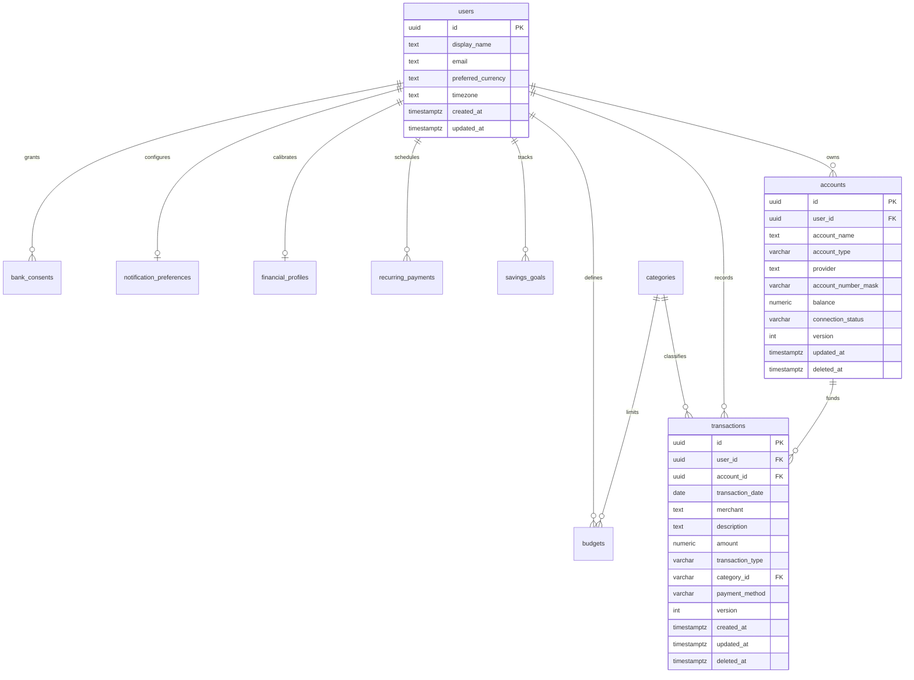

# PAISA — Database Schema & Concurrency Architecture
**Document ID:** `docs/PAISA_DATABASE_SCHEMA.md`  
**Execution Stage:** Stage Two & Three — Data Layer Design & Supabase Schema  
**Author:** Software Architecture, Database & Security Engineering Team  
**Date:** October 31, 2026  
**Status:** COMPLETE & VERIFIED  

---

## 1. Schema Design Philosophy

PAISA operates on a **Local-First, Dual-Engine Architecture**:
1. **Primary Operational Engine (Local Device)**:
   - **Web / PWA**: IndexedDB (`paisa_offline_db`) with transactional object stores.
   - **Native Android / iOS**: Platform-appropriate persistent store (LevelDB-backed IndexedDB in Capacitor / SQLite with SQLCipher encryption).
   - Zero-latency reads/writes, zero reliance on live network connections.
2. **Cloud Synchronization Engine (Supabase PostgreSQL 17)**:
   - Hosted at project `hpscyhvlbisquajditpg` in Mumbai (`ap-south-1`).
   - Tenant isolation enforced strictly at the database level using Postgres **Row Level Security (RLS)** via `auth.uid() = user_id`.
   - Additive versioning, concurrency counters (`version`), and soft-deletion tombstones (`deleted_at`).

---

## 2. Entity Relationship & Data Flow Architecture



---

## 3. Local Database Schema (IndexedDB / SQLite)

### 3.1 Object Stores & Keys
All local tables inherit the `SyncMetadata` interface:

```typescript
export interface SyncMetadata {
  version: number;             // Concurrency sequence (starts at 1)
  sync_status: SyncStatus;     // 'synced' | 'pending_insert' | 'pending_update' | 'pending_delete' | 'failed' | 'conflict'
  created_at: string;          // ISO 8601 UTC
  updated_at: string;          // ISO 8601 UTC
  deleted_at?: string | null;  // Soft-deletion tombstone ISO timestamp
  last_synced_at?: string | null;
  conflict_data?: Record<string, unknown> | null;
}
```

### 3.2 Store Definitions
1. **`transactions`**
   - **KeyPath:** `id` (UUID / text)
   - **Indexes:** `user_id`, `transaction_date`, `category_id`, `sync_status`, `deleted_at`
2. **`accounts`**
   - **KeyPath:** `id`
   - **Indexes:** `user_id`, `sync_status`, `deleted_at`
3. **`budgets`**
   - **KeyPath:** `id`
   - **Indexes:** `user_id`, `sync_status`, `deleted_at`
4. **`categories`**
   - **KeyPath:** `id`
   - **Indexes:** `user_id`, `sync_status`
5. **`savings_goals`**
   - **KeyPath:** `id`
   - **Indexes:** `user_id`, `sync_status`, `deleted_at`
6. **`recurring_payments`**
   - **KeyPath:** `id`
   - **Indexes:** `user_id`, `sync_status`, `deleted_at`
7. **`financial_profiles`**
   - **KeyPath:** `user_id` (1:1 with user)
   - **Indexes:** `sync_status`
8. **`notification_preferences`**
   - **KeyPath:** `user_id`
   - **Indexes:** `sync_status`
9. **`bank_consents`**
   - **KeyPath:** `id`
   - **Indexes:** `user_id`, `sync_status`
10. **`outbox_mutations` (Durable Offline Queue)**
    - **KeyPath:** `id`
    - **Fields:** `table_name`, `record_id`, `action` (`insert` | `update` | `delete`), `payload`, `client_timestamp`, `retry_count`, `status`, `error_message`
    - **Indexes:** `status`, `table_name`, `client_timestamp`
11. **`migration_meta`**
    - **KeyPath:** `id`
    - **Fields:** `version`, `migrated_at`, `status`, `pre_migration_totals`, `post_migration_totals`, `record_counts`, `verified`

---

## 4. Cloud Database Schema (Supabase PostgreSQL 17)

### 4.1 Schema Migration (`supabase/migrations/20261031_offline_sync_schema.sql`)
The cloud schema extends the baseline tables additively without modifying existing data:

```sql
-- Versioning and soft-deletion tombstones
ALTER TABLE public.transactions
  ADD COLUMN IF NOT EXISTS version INT DEFAULT 1 NOT NULL,
  ADD COLUMN IF NOT EXISTS deleted_at TIMESTAMPTZ DEFAULT NULL;

ALTER TABLE public.accounts
  ADD COLUMN IF NOT EXISTS version INT DEFAULT 1 NOT NULL,
  ADD COLUMN IF NOT EXISTS updated_at TIMESTAMPTZ DEFAULT NOW() NOT NULL,
  ADD COLUMN IF NOT EXISTS deleted_at TIMESTAMPTZ DEFAULT NULL;

ALTER TABLE public.budgets
  ADD COLUMN IF NOT EXISTS version INT DEFAULT 1 NOT NULL,
  ADD COLUMN IF NOT EXISTS updated_at TIMESTAMPTZ DEFAULT NOW() NOT NULL,
  ADD COLUMN IF NOT EXISTS deleted_at TIMESTAMPTZ DEFAULT NULL;
```

### 4.2 Automated Concurrency Trigger
PostgreSQL triggers automatically advance the entity version and timestamp on any cloud update:

```sql
CREATE OR REPLACE FUNCTION public.handle_entity_version_bump()
RETURNS TRIGGER AS $$
BEGIN
  NEW.version = COALESCE(OLD.version, 1) + 1;
  NEW.updated_at = NOW();
  RETURN NEW;
END;
$$ LANGUAGE plpgsql;
```

### 4.3 Row Level Security (RLS) & Tenant Isolation
All tables strictly enforce row-level tenant boundaries:
- `auth.uid() = user_id` for all operations (`SELECT`, `INSERT`, `UPDATE`, `DELETE`).
- Service role keys are **never bundled in frontend or mobile builds**.
- All cloud requests use standard Anon Public publishable keys subject to authenticated JWT claims.

---

## 5. Concurrency Control & Conflict Resolution Strategy

1. **Local Writes Win Locally**: Every user action (recording spend, editing an account balance) writes immediately to the local database and returns to the user in `< 10ms`.
2. **Optimistic Concurrency Detection**:
   - When synchronizing, the local sync engine submits `{ record, expected_version: local.version }`.
   - If `remote.version > expected_version`:
     - **Deterministic Reconciliation**: If fields modified locally do not collide with cloud changes, they are merged.
     - **Collision Handling**: If the same field was modified concurrently on two devices, the version with the later timestamp is preserved, and the prior version is archived in `conflict_data` for user review.
3. **Soft-Deletion Tombstones**: Deleting a record offline sets `deleted_at = NOW()` rather than running an immediate SQL `DELETE`. The cloud synchronizes the tombstone, ensuring other devices replicate the deletion.
