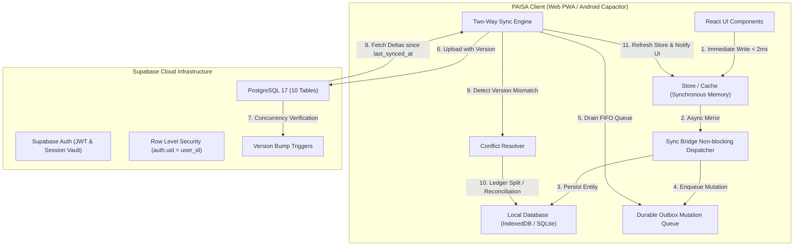

# PAISA — Two-Way Synchronization Architecture

**Author:** PAISA Engineering Team  
**Scope:** Stage Four Offline-First Data Synchronization  
**Version:** 1.0 (Production-Ready Architecture)

---

## 1. High-Level System Architecture

PAISA operates on a **Local-First, Cloud-Synchronized** topology. Every user interaction (creating an expense, editing an account balance, modifying a budget) takes place immediately on the local device. The cloud (Supabase PostgreSQL) serves as a durable backup, multi-device replica, and synchronization hub.

---

## 2. Core Architectural Components

### A. The Synchronous Store & Reactive UI
React UI components must render at 60 FPS without waiting for asynchronous disk writes or network requests. When a user logs an expense, `store.addTransaction()` updates the in-memory array and localStorage immediately (< 2 milliseconds).

### B. The Non-Blocking Sync Bridge (`src/lib/sync/syncBridge.ts`)
Immediately following the synchronous store update, the bridge asynchronously:
1. Calculates the next entity version number (`local_version + 1`).
2. Persists the full entity into `IndexedDBLocalDatabase` (`paisa_offline_db`).
3. Enqueues an `OutboxMutation` with action (`insert`, `update`, `delete`), timestamp, and full entity payload.
4. Triggers background synchronization if the device is currently online.

### C. The Durable Outbox Queue (`src/lib/db/types.ts`)
The outbox stores pending changes that must be transmitted to Supabase.
- **Strict FIFO Ordering:** Mutations are sorted chronologically by `client_timestamp ASC`.
- **Durable Retention:** A mutation is **never removed** from the outbox until the cloud confirms an HTTP 200 / PostgREST 201/204 response.
- **Retry Backoff:** On network timeout or connection failure, `retry_count` is incremented, and status is marked `failed` awaiting the next connection window.
- **Deletions via Tombstones:** Deletions record a soft-deletion marker (`deleted_at: timestamp`). This ensures the deletion replicates to other devices rather than being treated as a missing row.

### D. The Two-Way Sync Engine (`src/lib/sync/syncEngine.ts`)
The Sync Engine orchestrates two continuous loops:

#### 1. Outbound Loop (Push / Upload)
1. Checks network connectivity (`navigator.onLine`) and user authentication (`authService.getCurrentSession()`).
2. Pulls up to 50 pending mutations from the outbox in chronological order.
3. Checks user tenancy: verifies that `mutation.payload.user_id` strictly matches the authenticated session user ID.
4. Sends mutation to cloud via `SupabaseCloudSyncAdapter`:
   - `insert`: Idempotent upsert matching primary key UUID.
   - `update`: Checks remote version vs local base version. If remote version has progressed, flags a conflict.
   - `delete`: Sends `deleted_at: timestamp` update.
5. On success: Marks local record `synced`, records `last_synced_at`, and deletes the mutation from the outbox.

#### 2. Inbound Loop (Pull / Download)
1. Queries each table in Supabase for records where `user_id = auth.uid()` and `updated_at > last_synced_at`.
2. For each remote entity:
   - If local draft has an uncommitted outbox mutation: Checks for conflict. Never silently clobbers dirty local drafts.
   - If local record is clean: Updates local database with remote payload.
   - If remote has `deleted_at`: Soft-deletes the local record.
   - If record is new (created on another device): Inserts cleanly into local database.
3. Synchronizes downloaded updates back into `store` and triggers `notifyListeners()`, causing React views to update automatically.

---

## 3. Storage Hierarchy: Local vs Cloud

| Data Entity | Local Device (Offline) | Supabase Cloud (Online) | Synchronization Semantics |
|---|:---:|:---:|---|
| **Transactions** | Yes (Primary) | Yes (Replica) | Two-way. Full ledger preservation. |
| **Bank Accounts** | Yes (Primary) | Yes (Replica) | Two-way. Balance reconciled against transactions. |
| **Budgets** | Yes (Primary) | Yes (Replica) | Two-way. Limit and month sync. |
| **Savings Goals** | Yes (Primary) | Yes (Replica) | Two-way. Target and current amounts sync. |
| **Recurring Bills** | Yes (Primary) | Yes (Replica) | Two-way. Frequency and next due date sync. |
| **Categories** | Yes (Primary) | Yes (Replica) | Two-way. Custom user categories sync. |
| **Financial Profile** | Yes (Cached) | Yes (Replica) | Two-way. Target allocations sync. |
| **Outbox Mutations** | Yes (Device-Only) | No | Outbox queue is strictly local to each device. |
| **Sync Conflicts** | Yes (Device-Only) | No | Local conflict vault until resolved by user. |
| **Auth Credentials** | Secure Local Vault | Supabase Auth | Passwords never sent in plaintext; salted hashes only. |

---

## 4. Multi-Device Topology & Conflict Detection

When a user uses PAISA on both a Phone (Android) and a Laptop (Web):
1. **Device A (Offline Phone):** Logs a grocery expense of ₹450 (v1 -> v2).
2. **Device B (Laptop):** Changes the same transaction to ₹500 (v1 -> v2) and syncs to Supabase.
3. **Reconnection:** When Device A reconnects, its outbox sends v2 based on v1.
4. **Cloud Detection:** Supabase is already at v2. The Sync Engine halts the overwrite and routes the discrepancy to the **Conflict Resolver**.
5. **Ledger Protection:** Rather than dropping either edit, PAISA offers a `split_transaction` option that keeps both records so zero rupees are lost from the ledger.

---

## 5. Security & Isolation Invariants

1. **Zero Privileged Secrets:** No Supabase service-role keys are present in frontend bundles.
2. **PostgreSQL RLS:** All cloud queries enforce `auth.uid() = user_id`.
3. **Client Tenancy Filter:** Sync engine rejects any outbox mutation whose `user_id` does not match the active session.
4. **Local PDF Statement Privacy:** Bank statement parsing (PDF/Excel) runs 100% in-browser; statement passwords and raw files are never transmitted to any cloud server.
