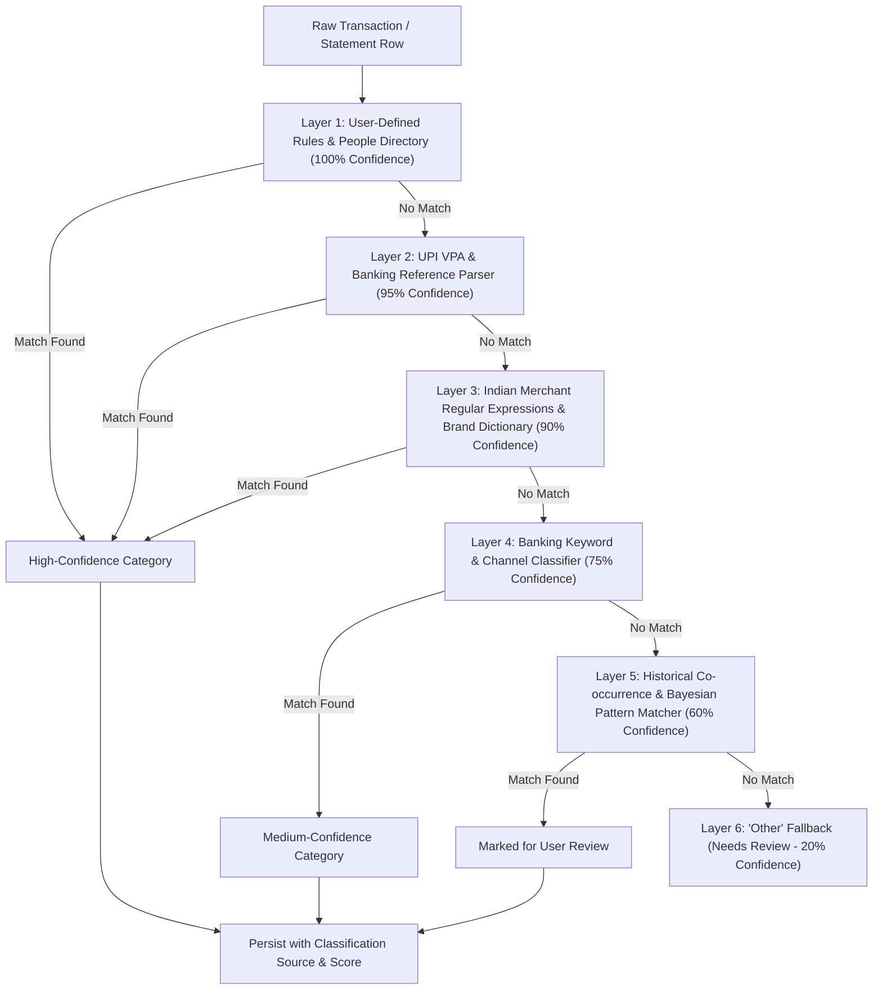

# PAISA — Transaction Intelligence & Clean Slate Architecture Specification

**Author:** PAISA Core Architecture Team  
**Scope:** Transformation from Demo-Seeded Dashboard to Real-Data Transaction Intelligence Platform  
**Document Version:** 1.0 (Master Engineering Specification)  
**Date:** 2026-10-31

---

## 1. Existing Capabilities

PAISA currently possesses strong functional building blocks:
- **Offline-First Data Layer:** IndexedDB (`paisa_offline_db`) with transactional object stores, monotonic versioning (`v1, v2`), durable outbox mutations (`OutboxMutation`), and soft-deletion tombstones (`deleted_at`).
- **Two-Way Synchronization Engine:** Background outbox drainer, cloud delta puller (`updated_at > last_synced_at`), exponential backoff, and tenant isolation using Supabase Auth.
- **Supabase Cloud Backend:** Active PostgreSQL database on project `hpscyhvlbisquajditpg` with Row Level Security, concurrency bump triggers, and 10 delta indexes.
- **Client-Side File Parsers:** In-browser statement processing supporting CSV, JSON, Excel (`.xlsx`, `.xls`), and password-protected PDF bank statements.
- **Financial Arithmetic Core:** Strict integer paise currency calculations, avoiding floating-point rounding errors.
- **Rich Dashboard UI:** Daily reality check banners, spending timelines, monthly charts, and categorization badges.

---

## 2. Existing Problems & Root Causes

1. **The "Fabricated Life" Problem (Seeded Demo Data):**
   - In `src/lib/storage.ts` (lines 63–444), the application hardcodes `DEFAULT_USER` ("Atharva"), `DEFAULT_PROFILE` (₹1,00,000 income), `DEFAULT_ACCOUNTS` (HDFC ₹70,500, ICICI ₹1,45,000, etc.), `DEFAULT_TRANSACTIONS` (180+ lines of fake Swiggy, Blinkit, Salary), `DEFAULT_RECURRING` (Netflix, Rent), and `DEFAULT_SAVINGS_GOALS`.
   - When a fresh user opens the app, `store.init()` and fallback lookups (`getStored(key, DEFAULT_...)`) immediately inject this fabricated financial history.
   - The user is greeted not with their actual money, but with an imaginary financial life.
2. **The "Everything is Other" Categorization Problem:**
   - In `src/lib/categorization.ts`, `suggestCategory` relies entirely on basic substring matching (`combined.includes(kw)`).
   - Real-world Indian bank statements and UPI payment descriptions contain structured metadata (e.g. `UPI/CR/430123456789/Sharma Ji Kirana/PAYTM/paytm-123`, `POS 412345XXXXXX1234 STARBUCKS BLR`, `NEFT CR-CITI0000001-SALARY OCT 2026`).
   - The simple substring lookup fails to match these patterns, causing the overwhelming majority of imported transactions to fall back to `cat_other` with low confidence.
3. **No Directory for People & Merchants:**
   - The user cannot explicitly define who a recipient is (e.g., "Landlord", "Gym Trainer", "House Help", "College", "Friend").
   - There is no mechanism to ask the user: *"Should this categorization rule apply to future transactions, historical transactions, or both?"*
4. **Disconnect Between Dashboard Metrics and Real Transaction State:**
   - Dashboard calculations fall back to `profile.monthly_income` when transaction income is zero.
   - If accounts are empty, the balance is inferred from static profile parameters instead of reflecting the actual database state (₹0).

---

## 3. Demo-Data Sources & Cleanup Audit Findings

| Source Location | Type of Demo Data | Proposed Cleanup Action |
|---|---|---|
| `src/lib/storage.ts`: `DEFAULT_USER` | Hardcoded demo user "Atharva" (`usr_paisa_demo_1`) | Remove. Default to authenticated auth user or anonymous clean vault (`id: ''`, `display_name: 'My Account'`). |
| `src/lib/storage.ts`: `DEFAULT_PROFILE` | Hardcoded ₹1,00,000 income, ₹25,000 commitments | Remove. Default to zero income (`monthly_income: 0`, `fixed_commitments: 0`, `savings_target: 0`). |
| `src/lib/storage.ts`: `DEFAULT_ACCOUNTS` | 5 fake bank accounts (HDFC, ICICI, SBI, Millennia CC) | Remove. Default to empty array `[]`. |
| `src/lib/storage.ts`: `DEFAULT_TRANSACTIONS` | 180+ lines of fake transactions | Remove. Default to empty array `[]`. |
| `src/lib/storage.ts`: `DEFAULT_RECURRING` | Fake Netflix, Rent, Spotify subscriptions | Remove. Default to empty array `[]`. |
| `src/lib/storage.ts`: `DEFAULT_SAVINGS_GOALS` | Fake Emergency Fund, Japan Trip, MacBook | Remove. Default to empty array `[]`. |
| `src/lib/storage.ts`: `DEFAULT_CATEGORY_BUDGETS` | Hardcoded default budget limits (Food 12000...) | Remove. Default to empty object `{}`. |
| `src/lib/storage.ts`: `DEFAULT_CONSENTS` | Fake bank account aggregator consent | Remove. Default to empty array `[]`. |
| `src/lib/storage.ts`: `store.init()` | Calls `setStored` with all demo constants | Refactor to initialize clean empty state (`[]`, `{}`). |
| Unit Test Fixtures (`src/test/*.ts`) | Unit tests needing sample records | Isolate test fixtures into `src/test/fixtures/` without polluting production storage. |

---

## 4. Real-Data-Only Initialization Behaviour

When a new user launches PAISA with zero transactions:

| Metric / Screen Element | Value for New User | Data Source |
|---|:---:|---|
| **Total Balance** | **₹0.00** | Sum of actual user-added accounts or verified net cash flow. |
| **Total Income** | **₹0.00** | Sum of actual transactions where `transaction_type === 'income'`. |
| **Total Expenses** | **₹0.00** | Sum of actual transactions where `transaction_type === 'expense'`. |
| **Transactions Count** | **0** | `transactions.length`. |
| **Active Budgets** | **0** | `Object.keys(budgets).length`. |
| **Savings Goals** | **0** | `goals.length`. |
| **Financial History / Charts** | **Empty State** | Displays guidance: *"No financial history yet. Upload a bank statement or add your first expense to begin."* |

### Empty State Guiding Cards:
1. **Upload Bank Statement:** Direct button to Excel/PDF/CSV statement import modal.
2. **Add Manual Transaction:** Quick action to record cash or immediate UPI spends.
3. **Add Bank Account:** Prompts user to record their actual bank account and starting balance.
4. **Enable 24×7 Android Transaction Detection:** (On Android) Explains notification permissions to detect UPI/Card transactions automatically.

---

## 5. Enhanced Transaction Data Model

To support historical statement analysis, multi-layer categorization, and people intelligence, the `Transaction` entity in `src/types.ts` is upgraded:

```typescript
export type TransactionDirection = 'debit' | 'credit' | 'transfer';
export type TransactionSource = 'manual' | 'statement_import' | 'android_notification' | 'bank_sync';
export type ClassificationSource = 'user_rule' | 'person_directory' | 'upi_vpa' | 'merchant_regex' | 'historical_pattern' | 'default_fallback';

export interface Transaction {
  id: string; // UUID
  user_id: string;
  account_id?: string;
  category_id: string;
  amount: number; // Integer paise (e.g. 45000 = ₹450.00)
  transaction_type: 'expense' | 'income' | 'transfer';
  merchant: string;
  description: string;
  raw_description?: string; // Untouched original bank string
  transaction_date: string; // YYYY-MM-DD or ISO
  payment_method: PaymentMethod;
  
  // Intelligence & Metadata
  direction?: TransactionDirection;
  source?: TransactionSource;
  person_id?: string; // Linked Person / Merchant entity
  vpa_address?: string; // Extracted UPI VPA (e.g. swiggy@icici)
  reference_number?: string; // RRN / UTR / Check number
  balance_after?: number; // Integer paise running balance if provided by bank
  
  // Categorization Explainability
  confidence?: number; // 0.00 to 1.00
  confidence_tier?: 'high' | 'medium' | 'low' | 'needs_review';
  classification_source?: ClassificationSource;
  classification_explanation?: string;
  is_reviewed?: boolean;
  
  // Financial Semantics
  is_credit_card_payment?: boolean;
  is_internal_transfer?: boolean;
  is_recurring?: boolean;
  recurring_period?: 'daily' | 'weekly' | 'monthly' | 'quarterly' | 'yearly';
  
  notes?: string;
  external_transaction_id?: string;
  created_at: string;
  updated_at: string;
}
```

---

## 6. Multi-Layer Intelligent Categorization Engine

Instead of a single naive substring check, the engine in `src/lib/transactionIntelligence.ts` executes a **6-Layer Resolution Pipeline**:



### Categorization Details:
- **Layer 1 (User Rules & People Directory):** Exact merchant names, recipient phone numbers, or user-defined regex rules.
- **Layer 2 (UPI VPA Parser):** Extracts `@okhdfcbank`, `@paytm`, `@ybl`, `@icici`, `@axl`. Recognizes merchant prefixes like `swiggy@...`, `zomato@...`, `cred@...`.
- **Layer 3 (Indian Merchant Regex):** Handles complex bank description patterns (`POS 4123...`, `ACH D-`, `BIL/INFT/`, `NEFT CR-`).
- **Layer 4 (Banking Keywords):** Detects `SALARY`, `INTEREST`, `DIVIDEND`, `TAX`, `CASH WDL`, `ATM`, `ANNUAL FEE`.
- **Layer 5 (Historical Learning):** If the user previously categorized "Ramesh General Store" as `cat_groceries`, future payments to "Ramesh" inherit `cat_groceries`.
- **Layer 6 (Fallback):** Only assign `cat_other` when all 5 layers yield zero match, explicitly tagging `is_reviewed: false` and `confidence_tier: 'needs_review'`.

---

## 7. People & Merchants Intelligence Feature

### Design Principles:
1. **Starts 100% Empty:** No predefined landlords, gym owners, or friends.
2. **User-Defined Entities:**
   ```typescript
   export type PersonRelationship = 
     | 'landlord'
     | 'friend'
     | 'family'
     | 'employer'
     | 'service_provider'
     | 'gym_trainer'
     | 'college_school'
     | 'grocery_merchant'
     | 'business'
     | 'custom';

   export interface PersonEntity {
     id: string; // UUID
     user_id: string;
     display_name: string;
     relationship: PersonRelationship;
     default_category_id: string;
     aliases: string[]; // Variations of merchant/UPI strings
     upi_vpa?: string;
     account_number_mask?: string;
     phone_number?: string;
     notes?: string;
     apply_to_historical: boolean;
     apply_to_future: boolean;
     total_paid_paisa: number;
     transaction_count: number;
     created_at: string;
     updated_at: string;
   }
   ```
3. **Interactive Confirmation Dialog:**
   When a user links a transaction to a person or merchant:
   > *"You identified 'Ramesh Chandra' as your Landlord with category 'Rent (₹22,000)'.  
   > How should PAISA apply this rule?*
   > - **Both Historical & Future:** Update 3 matching past transactions and all future transactions.
   > - **Future Only:** Leave historical records unchanged; apply to future imports.
   > - **This Transaction Only:** Do not create an automated rule.

---

## 8. Historical Bank Statement Import Pipeline

The existing CSV, Excel, and PDF parser (`src/lib/csvParser.ts`) is upgraded to a multi-year chronological pipeline:
1. **Universal Indian Date Normalization:** Correctly parses `DD/MM/YYYY`, `DD-MM-YYYY`, `DD-MMM-YYYY`, `YYYY-MM-DD` avoiding month/day inversion bugs.
2. **Integer Paise Ledger Normalization:** Strips currency symbols (`₹`, `INR`, `,`), handles credit/debit indicator columns (`Cr`/`Dr`, `Deposit`/`Withdrawal`), and stores pure integer paise.
3. **Duplicate Detection:** Checks `(user_id, transaction_date, amount, merchant)` and external reference IDs (`RRN`/`UTR`) to prevent double imports.
4. **Summary Card:** Outputs:
   - Date range detected (e.g. *"Covers 01 Jan 2024 to 31 Dec 2025 (24 months)"*)
   - Total records, parsed, duplicates skipped, requiring review
   - Total inflows (credits) & total outflows (debits)
   - Category distribution preview before committing

---

## 9. Comprehensive Financial Calculation Engine

All metrics are 100% traceable to actual transaction rows:
- **Net Balance:** $\sum \text{Income} - \sum \text{Expense} \pm \text{Account Adjustments}$
- **Date Filter Ranges:**
  - Today, This Week, This Month, This Quarter, This Year, Financial Year (Apr 1 - Mar 31)
  - Custom arbitrary date ranges
- **Multi-Year Trend Analysis:** Grouping by `YYYY-MM` or `YYYY-WW` with zero floating point drift.
- **Self-Transfer Elimination:** Transactions marked `is_internal_transfer` or `is_credit_card_payment` are excluded from income and expense aggregates to prevent artificial inflation.

---

## 10. Natural-Language Financial Inquiry Engine

Enables users to ask conversational questions in the search/command bar:
- *"How much did I spend on food this month?"*
- *"How much did I pay my landlord this year?"*
- *"What was my highest spending day?"*
- *"Compare this month with last month."*

### Architectural Safety Rule:
**AI is NEVER allowed to invent numerical answers.**  
The Natural-Language Engine parses the intent into a deterministic query parameter:
`{ intent: 'sum_spending', category_id: 'cat_food', period: 'current_month' }`  
The deterministic integer paise calculation engine executes the query and returns exact data:
`{ totalPaise: 450000, count: 8, currency: '₹4,500.00' }`  
The language model simply formats the verified response into natural English.

---

## 11. Android 24×7 Transaction Detection Architecture

### Architecture:
- Uses Android `NotificationListenerService` via a dedicated native Capacitor plugin bridge (`PaisaNotificationPlugin`).
- **Explicit Opt-In:** Feature is OFF by default. Requires user to explicitly open Android Settings and grant Notification Access.
- **Whitelist Filtering:** Only parses notifications from verified Indian financial package IDs:
  - `com.google.android.apps.nbu.paisa.user` (Google Pay)
  - `com.phonepe.app` (PhonePe)
  - `net.one97.paytm` (Paytm)
  - `com.snapwork.hdfc` (HDFC Bank)
  - `com.sbi.lotusintouch` (SBI Yono)
  - `com.csam.icici.bank.imobile` (ICICI iMobile)
  - `com.axis.mobile` (Axis Bank)
  - `com.msf.kbank.mobile` (Kotak)
  - `com.dreamplug.androidapp` (Cred)
- **Privacy Protections:**
  - Ignores OTP messages (`contains 'OTP'`, `'verification code'`).
  - Discards raw notification body after extracting `(amount, merchant, date, direction)`.
  - Never transmits notification text to external AI services.

---

## 12. iOS Platform Capabilities & Honest Boundaries

- **iOS Limitation:** Apple iOS does **not** permit third-party applications to listen to notifications emitted by other apps.
- **Honest Communication:** The app does not display fake or unavailable notification tracking switches on iOS. Instead, it prominently surfaces:
  - Bank statement PDF/Excel drag-and-drop
  - Fast manual expense widgets
  - RBI Account Aggregator (AA) consent flows

---

## 13. Implementation Phases

1. **Phase 1: Clean Slate Initialization:** Remove demo data from `storage.ts`, ensure zero-state defaults, and implement clean empty state UI components.
2. **Phase 2: Enhanced Transaction Model & Categorization Engine:** Implement `src/lib/transactionIntelligence.ts` with 6-layer categorization and explainability.
3. **Phase 3: People & Merchants Directory:** Implement storage, identity linking, and retrospective rule application.
4. **Phase 4: Time-Based & Multi-Year Financial Analytics:** Implement arbitrary date ranges, annual/financial-year summaries, and recurring payment detectors.
5. **Phase 5: Natural Language Financial Q&A:** Implement query parser and deterministic arithmetic respondent.
6. **Phase 6: Android Notification Plugin Skeleton:** Implement native service contract and permission state manager.
7. **Phase 7: Full Test Suite & Verification:** Ensure all 187+ tests pass and build succeeds.

---

## 14. Verification & Testing Strategy

- **Empty State Test:** Verify a brand new user loads ₹0 balance, ₹0 income, ₹0 expense, 0 transactions.
- **Categorization Accuracy Test:** Benchmark 50 realistic Indian bank statement strings across UPI, POS, NEFT, IMPS.
- **People & Merchants Test:** Verify zero pre-seeded entities, user identity creation, and rule propagation.
- **Financial Calculation Integrity:** Verify zero paisa arithmetic drift across all date filters.
